<p align="center">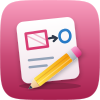</p>
<h1 align="center">Pocket Draw</h1>
<p align="center">Sketches, diagrams and flowcharts in one place. Draw on a hand-drawn whiteboard (Excalidraw), write a few lines and see a flowchart, timeline or mind map drawn (Mermaid), or build a detailed diagram with shape libraries (draw.io) — each drawing kept with its history, in folders, searchable by the words on it. Describe a diagram and let AI draw it; keep a copy of everything in your files. Moving in is dropping your <code>.excalidraw</code>, <code>.drawio</code> and <code>.mmd</code> files on the page.<br>One Go binary, one SQLite file, one volume. Part of the Pocket apps; works on its own too.</p>
<p align="center">
  <a href="https://github.com/abjelosevic88/pocket-homelab-draw/actions"></a>
  <a href="https://github.com/abjelosevic88/pocket-homelab-draw/pkgs/container/pocket-homelab-draw"></a>
  <a href="LICENSE"></a>
</p>

<p align="center">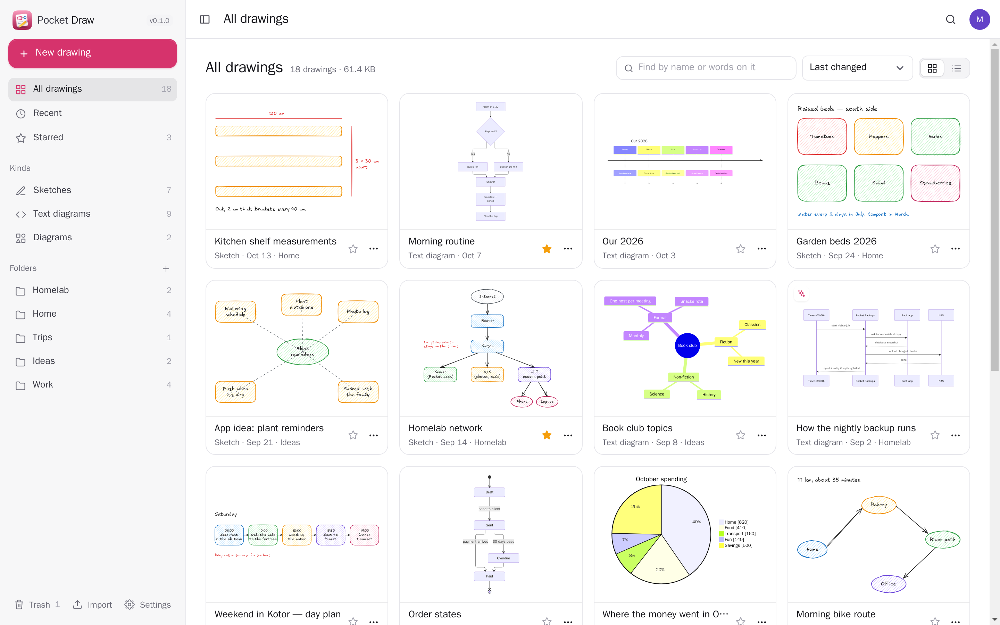</p>

<table>
  <tr>
    <td width="50%">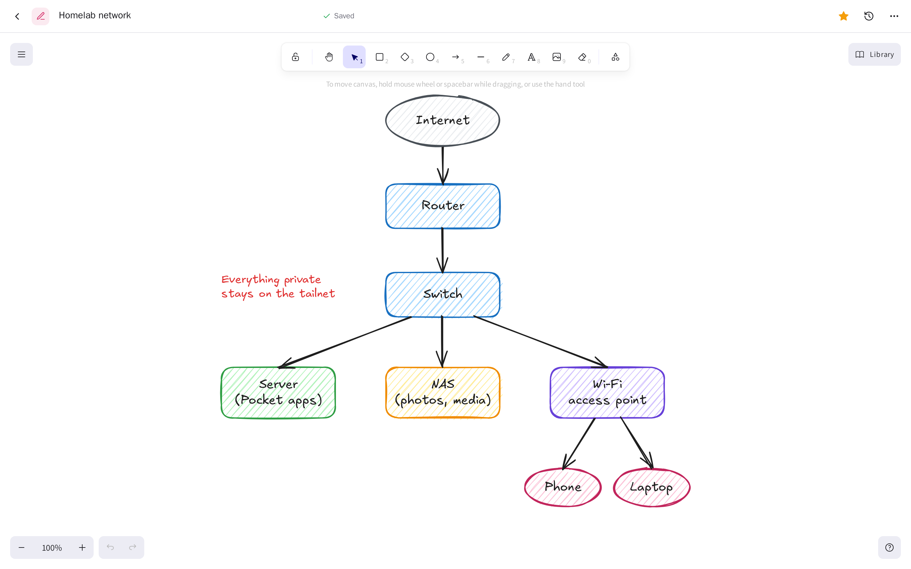</td>
    <td width="50%">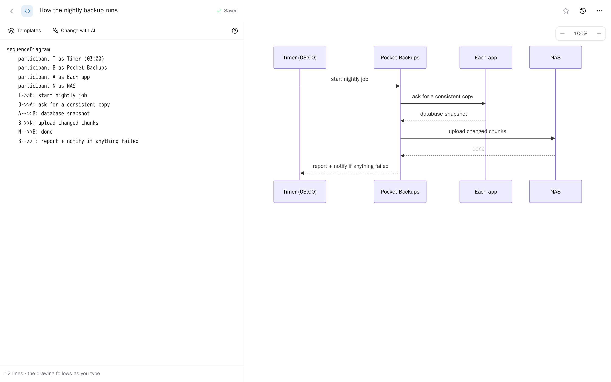</td>
  </tr>
  <tr>
    <td align="center"><sub>Sketches: Excalidraw, saved as you draw, with your own shapes library.</sub></td>
    <td align="center"><sub>Text diagrams: the drawing follows as you type; AI can draft, change or fix one.</sub></td>
  </tr>
  <tr>
    <td width="50%">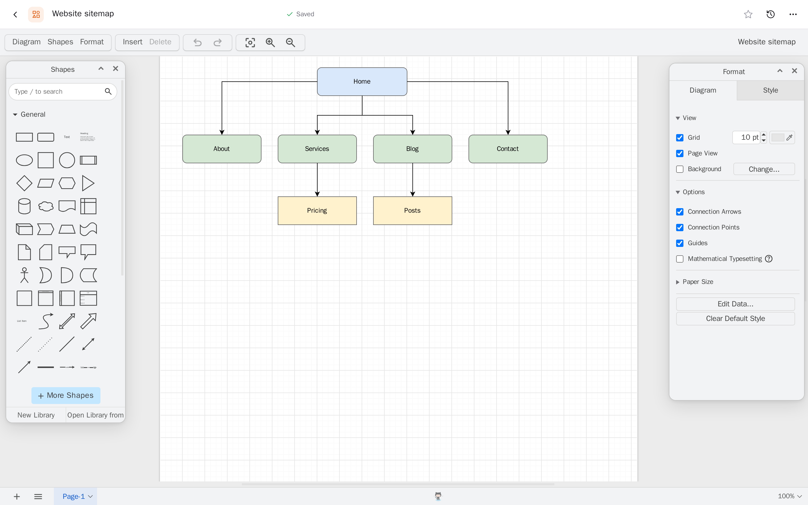</td>
    <td width="50%">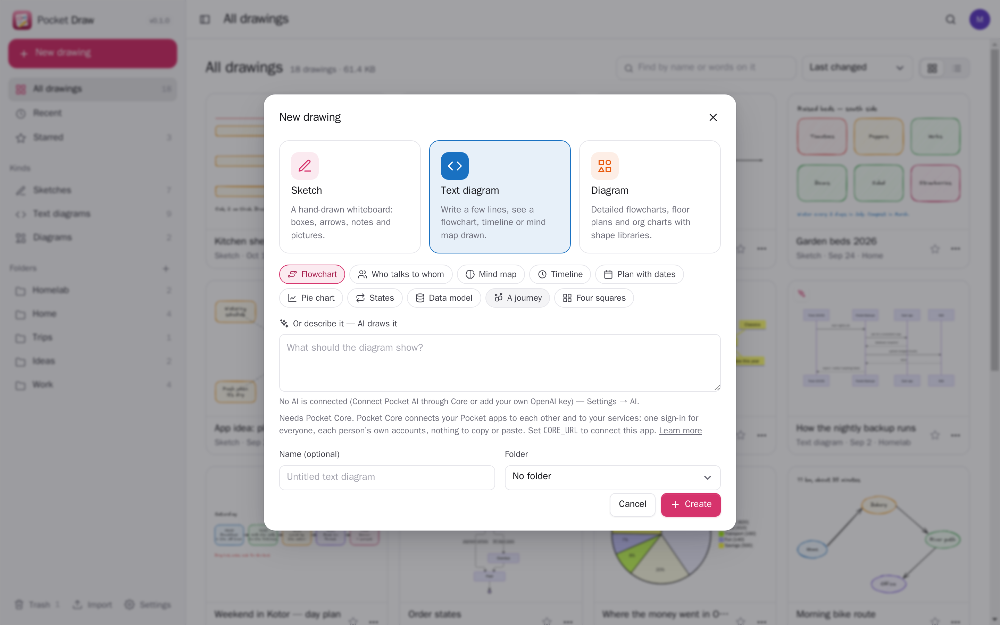</td>
  </tr>
  <tr>
    <td align="center"><sub>Diagrams: draw.io (your own server or diagrams.net), kept here.</sub></td>
    <td align="center"><sub>Start from a template, or describe it and let AI draw it.</sub></td>
  </tr>
  <tr>
    <td width="50%">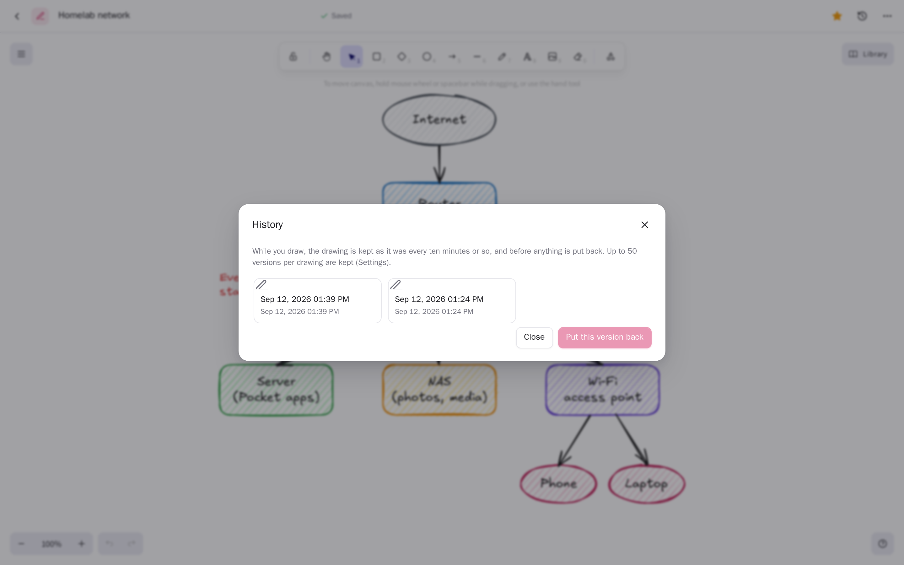</td>
    <td width="50%">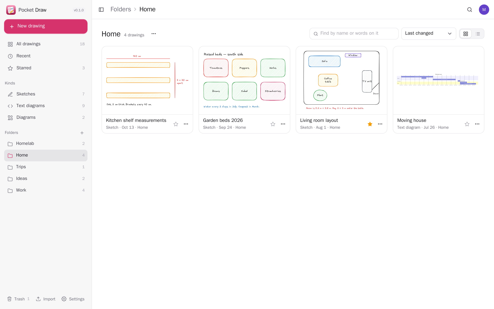</td>
  </tr>
  <tr>
    <td align="center"><sub>History: a version every ten minutes of drawing; put any one back.</sub></td>
    <td align="center"><sub>Folders, stars, recent, search by the words on a drawing.</sub></td>
  </tr>
</table>

<p align="center">
  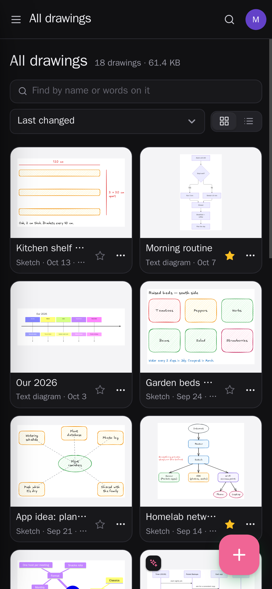&nbsp;&nbsp;
  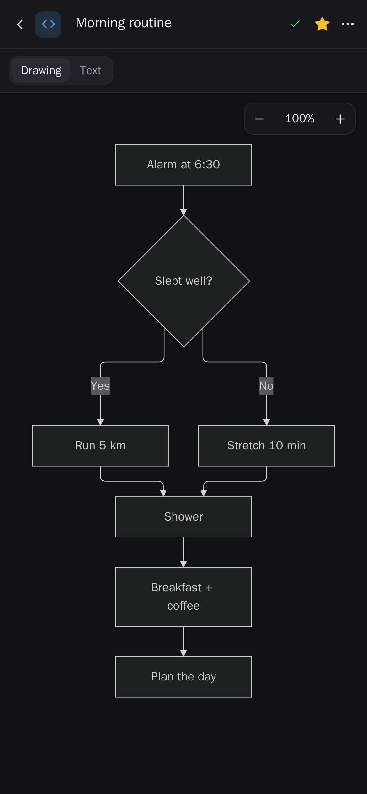&nbsp;&nbsp;
  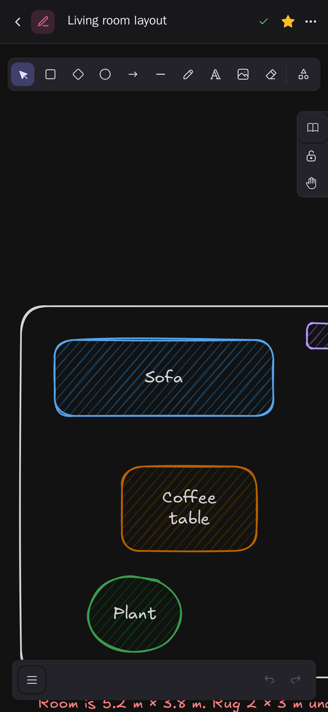
</p>

## What it does

- **Three kinds of drawing, one list**: sketches (Excalidraw: boxes, arrows, handwriting, pictures), text diagrams (Mermaid: flowcharts, sequences, mind maps, timelines, Gantt, pie, ER, state, journeys…) and diagrams (draw.io, opened from your own `jgraph/drawio` or diagrams.net). Each with a picture in the list.
- **Saves by itself**: a moment after you stop. Every save says which version it was made on, so two tabs or a linked app never overwrite each other silently — you choose “Load the newer one” or “Keep mine”.
- **History**: a version is kept every ten minutes or so while you draw, and before anything is put back; look at the pictures and restore any one.
- **Find things**: folders, stars, recently opened, and search by name and by the words *on* the drawing (sketch text, diagram labels, compressed draw.io pages included).
- **AI** (Pocket AI or your own OpenAI-compatible key): describe a diagram and get one, ask for a change (“add a step for paying”), or fix one Mermaid cannot draw.
- **Copies in Pocket Files**: each drawing as its picture and its own file in a folder of yours, kept up to date a couple of minutes after you stop.
- **Downloads**: SVG, PNG, or the `.excalidraw` / `.mmd` / `.drawio` file the original tools open.
- **Imports**: `.excalidraw` drawings and `.excalidrawlib` libraries, `.drawio`/`.xml`, `.mmd`, Markdown with ```` ```mermaid ```` blocks, Mermaid Live links — drop many files at once. A full JSON export imports twice without duplicates.
- **Self-contained**: Excalidraw's fonts are served by the app; no collaboration server, no calls out (draw.io only from the address you set).
- **Everyone their own**: each person has their own drawings, folders, library, settings and connections; admins see no one else's.

## Run it

```sh
docker run -d --name pocket-draw -p 8080:8080 -v ./data:/data \
  -e BASE_URL=https://draw.example.com -e SECURE_COOKIES=true \
  -e DRAWIO_URL=https://embed.diagrams.net \
  ghcr.io/abjelosevic88/pocket-homelab-draw:latest
```

or `docker compose up -d` with [docker-compose.yml](docker-compose.yml) (it has an optional `drawio` service). Open it, create the first account and start drawing. Without `DRAWIO_URL` sketches and text diagrams work; the Diagram kind is greyed out. All options: [docs/configuration.md](docs/configuration.md). API: [docs/api.md](docs/api.md).

## With Pocket Core

Set `CORE_URL` and `CORE_REGISTRATION_KEY` and Draw joins the box: people sign in with Pocket Core, copies go to each person's own Pocket Files through an app link (nothing to paste), and diagrams are drafted by Pocket AI. Other Pocket apps can see your drawings (`drawings:read`: Pocket Day's journal, dashboards) or add some (`drawings:write`: a diagram Pocket AI wrote); an app may change or remove only what it added. Events on the bus: `draw.created`, `draw.edited`, `draw.deleted`. Without Core the Files connection can be made directly with a URL and a token; the Core-only choices stay visible, greyed out.

## Develop

```sh
make dev     # API on :8080 with demo data + Vite on :5173
make test    # go vet, go test, tsc
make         # web + binary
```

Built on [Excalidraw](https://github.com/excalidraw/excalidraw) (MIT), [Mermaid](https://github.com/mermaid-js/mermaid) (MIT) and [draw.io](https://github.com/jgraph/drawio) (Apache 2.0, embedded from your server). MIT licensed.
